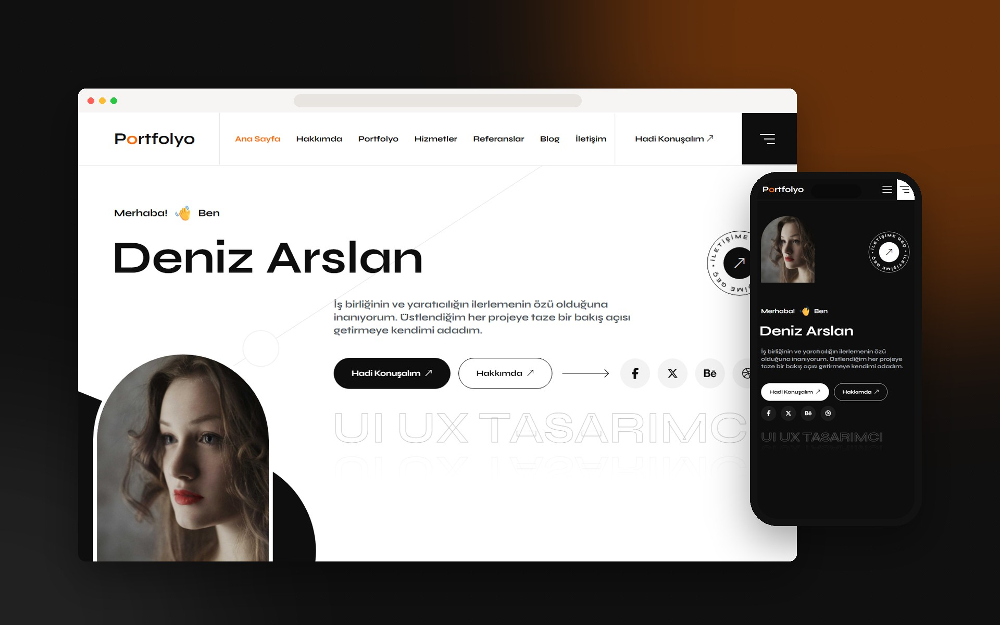
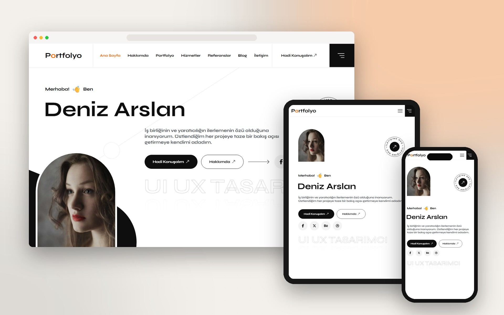
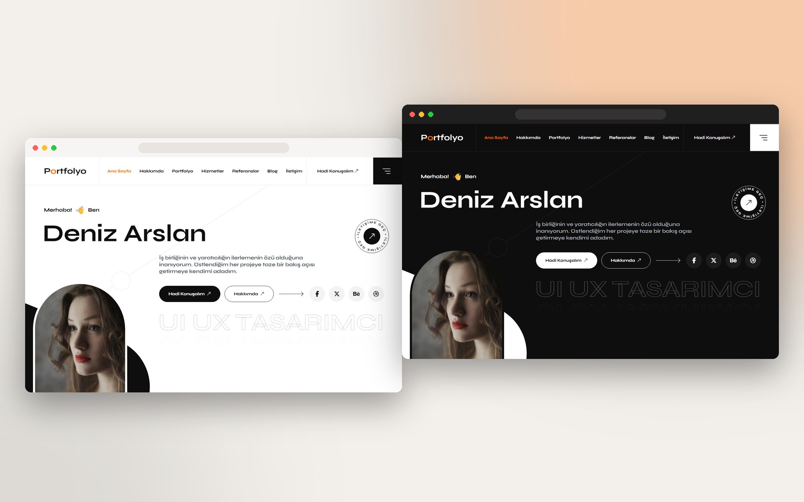
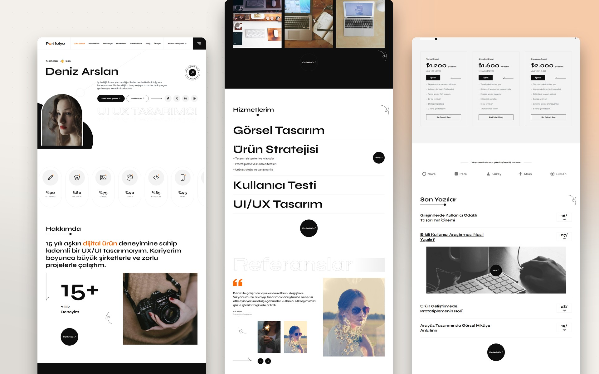
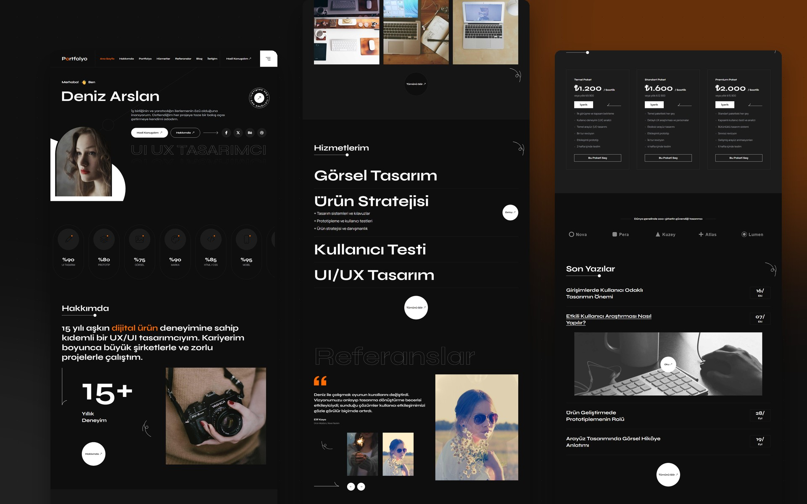
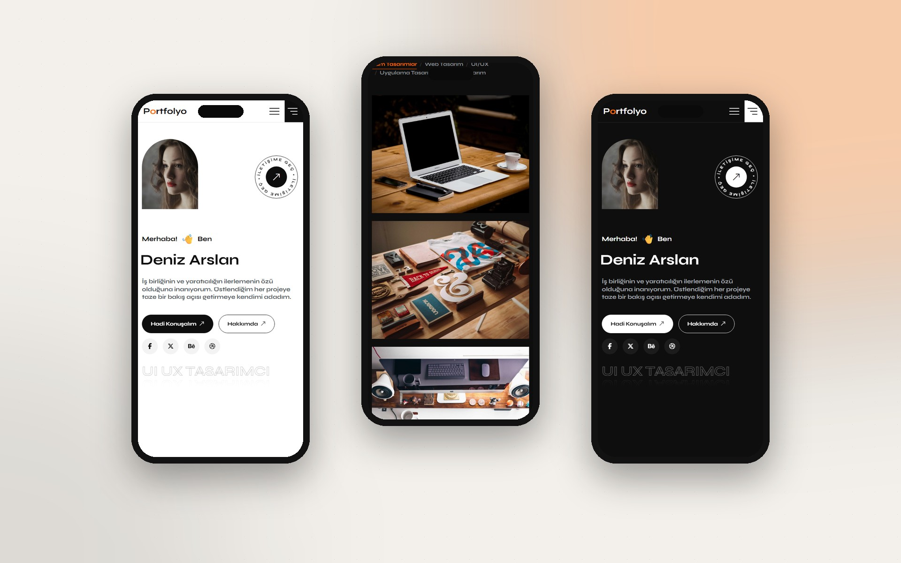
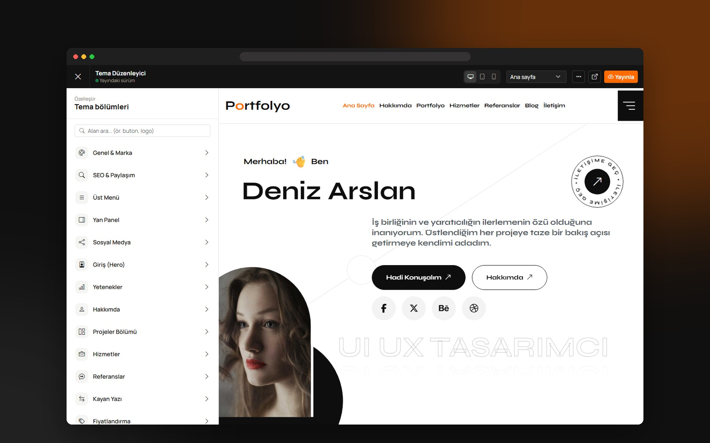
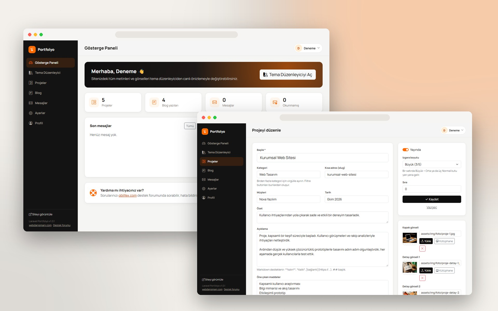
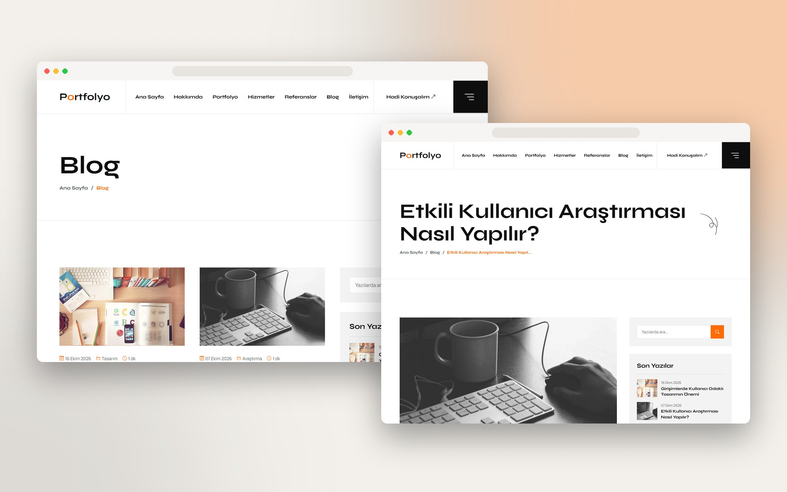

<div align="center">

# Laravel Portfolyo

**Admin panelli, canlı önizlemeli tema düzenleyicili kişisel portfolyo yazılımı**

[](https://github.com/webdanismani/laravel-portfolyo/actions/workflows/testler.yml)
[](https://github.com/webdanismani/laravel-portfolyo/releases/latest)


[](https://oblifex.com)

[webdanismani.com](https://webdanismani.com) tarafından **ücretsiz** dağıtılır · **Satışı yasaktır**

</div>

---



## 🖼️ Ekran görüntüleri

| | |
| --- | --- |
|  |  |
|  |  |
|  |  |
|  |  |

## ✨ Özellikler

- 🎨 **Canlı önizlemeli tema düzenleyici** — Sitedeki *tüm* metinleri, görselleri, bağlantıları, renkleri ve listeleri yazdıkça önizlemede görün. Masaüstü / tablet / mobil görünüm, önizlemede tıkla-düzenle, alan arama.
- 📝 **Taslak → Yayınla akışı** — Değişiklikler önce taslak olarak saklanır; ziyaretçiler siz "Yayınla"ya basana kadar hiçbir şey görmez.
- 🧩 **Bölüm yönetimi** — Giriş, yetenekler, hakkımda, projeler, hizmetler, referanslar, kayan yazı, fiyatlar, markalar, blog, iletişim. Her bölüm tek tıkla gizlenebilir, liste öğeleri eklenip sıralanabilir.
- 🗂️ **Projeler** — Kategori filtreleme, detay penceresi, ızgara boyutu seçimi, canlı proje bağlantısı.
- 📰 **Blog** — Markdown editör, kategoriler, etiketler, arama, zamanlanmış yayın.
- ✉️ **İletişim formu** — Gelen kutusu, okunmamış rozeti, e-posta bildirimi, bot tuzağı ve hız sınırı.
- 🖼️ **Medya kütüphanesi** — Görsel yükleme ve yeniden kullanma.
- 🌓 **Açık / koyu görünüm**, özelleştirilebilir vurgu rengi, açılış ve kaydırma animasyonları.
- 🚀 **Kolay kurulum** — Paylaşımlı hostinge yükleyin, tarayıcıdan kurulum sihirbazını tamamlayın.
- 🔁 **Tema dışa / içe aktarma** — Tasarımınızı JSON olarak yedekleyin veya başka siteye taşıyın.
- 🇹🇷 Tamamen Türkçe arayüz, SEO ve paylaşım (Open Graph) ayarları.

## 📋 Gereksinimler

- PHP **8.3** veya üstü (`pdo`, `mbstring`, `openssl`, `fileinfo`, `pdo_mysql` veya `pdo_sqlite` eklentileri)
- MySQL 5.7+ / MariaDB 10.3+ **veya** SQLite
- Apache (mod_rewrite) / LiteSpeed / Nginx

## 🚀 Kurulum

### Yöntem 1 — Hazır paket (paylaşımlı hosting, önerilen)

1. [Son sürüm sayfasından](https://github.com/webdanismani/laravel-portfolyo/releases/latest) `laravel-portfolyo-vX.Y.Z.zip` dosyasını indirin. *(Bu paket `vendor/` klasörünü içerir; Composer gerekmez.)*
2. Dosyaları sunucunuza yükleyip çıkartın.
3. Alan adınızın kök dizinini **`public/`** klasörüne yönlendirin.
   *Bu mümkün değilse dosyaları `public_html` içine çıkartın ve kök dizindeki `htaccess-kok-ornek.txt` dosyasının adını `.htaccess` yapın; istekler otomatik olarak `public/` klasörüne yönlendirilir.*
4. Sunucunuzda bir MySQL veritabanı oluşturun.
5. Tarayıcıdan sitenizi açın → **kurulum sihirbazı** otomatik açılır. Veritabanı ve yönetici bilgilerini girin. Bitti! 🎉

### Yöntem 2 — Composer

```bash
git clone https://github.com/webdanismani/laravel-portfolyo.git
cd laravel-portfolyo
composer install --no-dev --optimize-autoloader
cp .env.example .env
php artisan key:generate
# .env içinde DB_* ayarlarını yapın (varsayılan: SQLite)
php artisan portfolyo:kur
```

`portfolyo:kur` komutu tabloları oluşturur, örnek içeriği yükler ve yönetici hesabını sorar. Seçenekler: `--ad=`, `--eposta=`, `--sifre=`, `--demo=0`.

Yerel geliştirme için: `php artisan serve` → http://localhost:8000

## 🎛️ Kullanım

| Adres | Açıklama |
| --- | --- |
| `/yonetim` | Yönetim paneli |
| `/yonetim/tema` | Canlı önizlemeli tema düzenleyici |
| `/yonetim/projeler` | Projeler |
| `/yonetim/blog` | Blog yazıları |
| `/yonetim/mesajlar` | İletişim formundan gelen mesajlar |

### Tema düzenleyici ipuçları

- Önizlemede herhangi bir yazıya veya görsele **tıklayın** → soldaki panelde ilgili alan açılır.
- Metin, görsel ve renk değişiklikleri **anında** yansır; liste ekleme/silme gibi yapısal değişikliklerde önizleme kaydırma konumunuzu koruyarak yenilenir.
- *Hakkımda* metninde `{süslü parantez}` içine aldığınız kelimeler vurgu rengiyle gösterilir.
- Bağlantı alanlarında `#about`, `#contact` gibi bölüm adreslerini veya `/blog` gibi sayfa adreslerini kullanabilirsiniz.
- "⋯" menüsünden temayı **dışa aktarabilir**, başka bir kurulumda **içe aktarabilir** veya **varsayılana sıfırlayabilirsiniz**.

### E-posta bildirimleri

İletişim formu mesajlarının e-postanıza da gelmesi için `.env` dosyasında `MAIL_*` ayarlarını yapın ve **Yönetim → Ayarlar** sayfasından bildirim adresini girin.

## 🧱 Proje yapısı

```
app/Support/Tema.php          Tema değerleri: okuma, birleştirme, doğrulama, taslak/yayın
config/tema.php               Düzenlenebilir tüm alanların şeması (yeni alan = buraya bir satır)
resources/views/site/         Ön yüz şablonları ve bölümler
resources/views/yonetim/      Yönetim paneli
public/assets/                CSS, JS ve görseller (derleme adımı yok)
```

Yeni bir düzenlenebilir alan eklemek için `config/tema.php` içine tanımını yazın, şablonda `{{ tema('bolum.alan') }}` ile kullanın ve canlı önizleme için etikete `{{ dt('bolum.alan') }}` ekleyin.

## 🆘 Destek

- 💬 **Topluluk forumu: [oblifex.com](https://oblifex.com)** — kurulum, kullanım ve özelleştirme soruları
- 🐞 Hata bildirimi: [GitHub Issues](https://github.com/webdanismani/laravel-portfolyo/issues/new/choose)
- 🌐 Profesyonel hizmet: [webdanismani.com](https://webdanismani.com)

Ayrıntılar için [SUPPORT.md](SUPPORT.md).

## ⚖️ Lisans

Laravel Portfolyo, **[webdanismani.com](https://webdanismani.com) tarafından ücretsiz olarak dağıtılmaktadır.**

- ✅ Kendi sitelerinizde ve müşterileriniz için kurduğunuz sitelerde ücretsiz kullanabilir, dilediğiniz gibi değiştirebilirsiniz.
- ❌ **Yazılımın veya türevlerinin satışı yasaktır.** Ücretli pazar yerlerinde listelenemez, lisans ve atıflar kaldırılamaz.
- ⚠️ **Tespiti hâlinde DMCA politikası uygulanacaktır.**

Tam metin: [LICENSE](LICENSE)

<div align="center">
<sub>Laravel Portfolyo · <a href="https://webdanismani.com">webdanismani.com</a> · Destek: <a href="https://oblifex.com">oblifex.com</a></sub>
</div>
